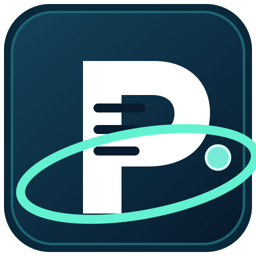
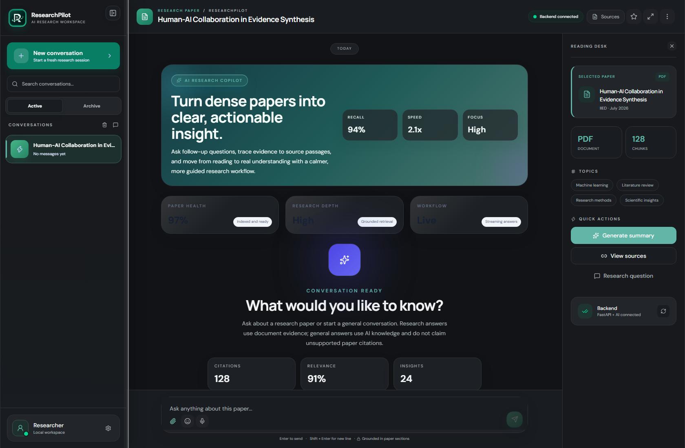
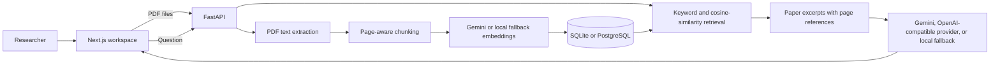

# ResearchPilot AI

<p align="center">
  
</p>

<p align="center"><a href="https://researchpilot-ai-roan.vercel.app/"><strong>Open the live frontend →</strong></a></p>

<p align="center">
  <strong>A research workspace for reading papers, asking grounded questions, and comparing evidence.</strong>
  <br />
  Upload PDFs, explore source passages, and keep paper conversations organized in one place.
</p>

<p align="center">
  <a href="https://github.com/GursimarpreetSingh-coder/researchpilot-ai"></a>
  <a href="https://nextjs.org/"></a>
  <a href="https://fastapi.tiangolo.com/"></a>
  <a href="https://www.sqlalchemy.org/"></a>
  <a href="https://ai.google.dev/gemini-api/docs"></a>
</p>

## Workspace preview

<p align="center">
  
</p>

The screenshot shows a sample paper workspace. The percentage and count cards in the interface are illustrative UI values, not measured service metrics.

## What it does

ResearchPilot connects paper reading with an AI-assisted research workflow:

- Upload up to eight PDF papers in one selection; each file can be up to 20 MB.
- Extract text by page, split it into overlapping chunks, and create embeddings for retrieval.
- Ask paper-specific questions and review the page and chunk references returned with an answer.
- Compare several selected papers in one conversation.
- Generate a structured summary with key findings, methods, and limitations.
- Open the paper PDF and jump to a page cited by a source.
- Ask general questions when a conversation has no linked paper; general answers are returned without paper citations.
- Search, archive, restore, and delete conversations. Adjust theme, voice input, and composer preferences in settings.
- Use voice dictation where the browser supports speech recognition.

## Screenshots


This fresh screenshot uses a sample paper. The percentage and chunk cards are illustrative UI values, not measured service metrics. Browser speech recognition and PDF viewing depend on the browser and an uploaded paper.

## How it works



### Paper question flow

1. The backend extracts text from each PDF page with `pypdf`.
2. Text is cleaned and split into overlapping chunks while retaining page numbers.
3. The backend stores chunks and their embeddings with the paper record.
4. A question is embedded and matched against the selected paper chunks. Retrieval combines cosine similarity with a lightweight keyword score.
5. The answer is generated from relevant excerpts and returned with paper, page, and chunk references. If there is no useful paper evidence, the assistant answers in general mode without inventing paper sources.

## Technology

| Area | Tools |
| --- | --- |
| Web app | Next.js 16, React 19, TypeScript, Tailwind CSS 4 |
| API | FastAPI, Uvicorn, Pydantic |
| Persistence | SQLAlchemy; SQLite for a simple local setup and PostgreSQL for hosted deployments |
| PDF processing | `pypdf`, page-aware chunking |
| Text generation and embeddings | Google Gemini by default; optional OpenAI-compatible text generation; local fallback when no provider is configured |
| Retrieval | JSON-stored embeddings, cosine similarity, and keyword scoring in Python |

## Run locally

### Requirements

- Node.js 20.9 or newer
- Python 3.11 or newer
- A Gemini API key for hosted AI answers and Gemini embeddings (optional; a local fallback is available)

Open two terminals from the repository root.

### 1. Start the backend

```powershell
cd backend
py -3.11 -m venv .venv
.\.venv\Scripts\Activate.ps1
pip install -r requirements.txt
Copy-Item .env.example .env
```

For a local SQLite database, edit `backend/.env` and set:

```env
DATABASE_URL=sqlite:///./researchpilot.db
CORS_ORIGINS=http://localhost:3000,http://127.0.0.1:3000
```

Add `GEMINI_API_KEY` to `.env` to use Gemini. The app creates missing database tables when it starts. To use PostgreSQL, set `DATABASE_URL` to its connection URL and apply the Alembic migrations before serving an existing database.

Start the API from the `backend` directory:

```powershell
python -m uvicorn app.main:app --reload --host 127.0.0.1 --port 8000
```

The API health endpoint is [http://127.0.0.1:8000/api/health](http://127.0.0.1:8000/api/health), and interactive API documentation is at [http://127.0.0.1:8000/docs](http://127.0.0.1:8000/docs).

### 2. Start the frontend

In a second terminal from the repository root:

```powershell
cd frontend
npm install
Copy-Item .env.example .env.local
npm run dev
```

Open [http://localhost:3000](http://localhost:3000). The frontend `.env.local` should point to the backend:

```env
NEXT_PUBLIC_API_URL=http://127.0.0.1:8000
```

### Optional AI providers

Gemini is the default provider. The backend also accepts an OpenAI-compatible chat endpoint:

```env
OPENAI_API_KEY=your_api_key
OPENAI_API_BASE=https://your-compatible-endpoint/v1
OPENAI_MODEL=your-chat-model
```

When no text-generation or embedding provider is configured, ResearchPilot can still respond using local fallback logic and locally generated hash embeddings. Those embeddings are a lightweight fallback and do not have the semantic quality of a hosted embedding model.

## Configuration

### Backend environment variables

| Variable | Purpose |
| --- | --- |
| `DATABASE_URL` | SQLAlchemy database URL. Defaults to a local SQLite database in the backend working directory. |
| `CORS_ORIGINS` | Comma-separated frontend origins allowed to call the API. |
| `GEMINI_API_KEY` | Enables Gemini text generation and embeddings. |
| `GEMINI_MODEL` | Gemini text-generation model name. |
| `GEMINI_FALLBACK_MODEL` | Optional Gemini model used when the primary model is rate-limited. |
| `GEMINI_EMBEDDING_MODEL` | Gemini model used for query embeddings. PDF indexing currently uses `gemini-embedding-001`; keep the models aligned and re-index papers if you change it. |
| `OPENAI_API_KEY` | Optional key for OpenAI-compatible text generation. |
| `OPENAI_API_BASE` | Optional base URL for an OpenAI-compatible endpoint. |
| `OPENAI_MODEL` | Chat model name for the OpenAI-compatible endpoint. |

Never commit `.env`, `.env.local`, API keys, database credentials, uploaded PDFs, local databases, or virtual environments.

## API overview

All routes are served by FastAPI. Open `/docs` for request schemas and interactive exploration.

| Method | Endpoint | Purpose |
| --- | --- | --- |
| `GET` | `/api/health` | Reports API, database, and AI-provider status. |
| `POST` | `/api/uploads/papers` | Upload and index one or more PDF papers (`files`). |
| `GET` | `/api/papers/{paper_id}` | Read paper metadata. |
| `GET` | `/api/papers/{paper_id}/pdf` | Stream the stored PDF. |
| `GET` | `/api/papers/{paper_id}/summary` | Generate or retrieve a structured summary. |
| `POST` | `/api/papers/{paper_id}/ask` | Ask a question about one paper. |
| `POST` | `/api/conversations` | Create a conversation, optionally linked to one or more papers. |
| `GET` | `/api/conversations?user_id={id}` | List conversations for a user. |
| `GET` | `/api/conversations/{conversation_id}` | Load a conversation and its messages. |
| `POST` | `/api/conversations/{conversation_id}/messages` | Save a message without running AI chat. |
| `POST` | `/api/conversations/{conversation_id}/chat` | Save a question and generate an answer. |
| `POST` | `/api/conversations/{conversation_id}/archive?user_id={id}` | Archive a conversation. |
| `POST` | `/api/conversations/{conversation_id}/unarchive?user_id={id}` | Restore an archived conversation. |
| `POST` | `/api/conversations/clear?user_id={id}` | Delete a user's conversation history. |
| `DELETE` | `/api/conversations/{conversation_id}?user_id={id}` | Delete one conversation. |

## Deploy

The repository includes a [Render Blueprint](render.yaml) for the FastAPI service and PostgreSQL database. A common deployment setup is:

The checked-in Render blueprint uses free resources for a temporary demo. Render free web services sleep after 15 idle minutes, free Postgres expires after 30 days, and uploaded PDFs live on ephemeral disk. Upgrade the service and database and add persistent file storage before treating this as a durable personal workspace. The frontend currently has no authentication; anyone who can reach a connected backend would share the demo workspace.

1. Deploy `backend/` and PostgreSQL using Render, Railway, or another Python host.
2. Configure `DATABASE_URL`, `GEMINI_API_KEY`, and `CORS_ORIGINS` in the backend service. Set CORS to the deployed frontend origin.
3. Apply the Alembic migrations to the hosted database.
4. Deploy `frontend/` to Vercel and set its project root directory to `frontend`.
5. Set `NEXT_PUBLIC_API_URL` to the deployed API URL and redeploy the frontend.

See [DEPLOYMENT.md](DEPLOYMENT.md) for provider-specific settings. Uploaded PDFs are stored under `backend/storage/papers`; this local directory is ignored by Git and is not durable storage on many hosted platforms. Use S3, Cloudflare R2, Supabase Storage, or equivalent persistent object storage before relying on production uploads.

## Project layout

```text
.
├── backend/
│   ├── alembic/          # Database migrations
│   ├── app/
│   │   ├── api/          # Upload, paper, conversation, and health routes
│   │   ├── core/         # Environment-backed settings
│   │   ├── db/           # SQLAlchemy base, session, and model registry
│   │   ├── models/       # Papers, chunks, users, conversations, and messages
│   │   └── services/     # PDF parsing, embeddings, retrieval, summaries, and AI
│   ├── requirements.txt
│   └── .env.example
├── docs/screenshots/     # README product screenshots
├── frontend/
│   ├── app/              # Next.js routes and design system
│   ├── components/       # Theme provider and reusable UI
│   ├── public/           # Logo and static assets
│   └── package.json
├── render.yaml           # Render service and database blueprint
├── DEPLOYMENT.md         # Hosted deployment notes
└── README.md
```

## Current scope and limitations

- The current workspace uses a fixed local demo user ID and does not implement sign-in or production-grade authorization. Do not expose a deployment to untrusted users as a multi-user service until authentication and access controls are added.
- PDF files are saved on the backend's local filesystem. Hosted deployments need persistent object storage to retain uploads across restarts or redeploys.
- Text extraction relies on embedded PDF text. Scanned pages require OCR, which is not currently included.
- Similarity search runs in Python over stored JSON embeddings; a vector database or `pgvector` index is not currently used.
- Gemini limits and quotas depend on the configured account and model. The backend returns provider errors when a request cannot be completed.

## License

No license file is included yet. Unless a license is added, the repository is not explicitly licensed for reuse or redistribution.

## Author

Built by [Gursimarpreet Singh](https://github.com/GursimarpreetSingh-coder).
